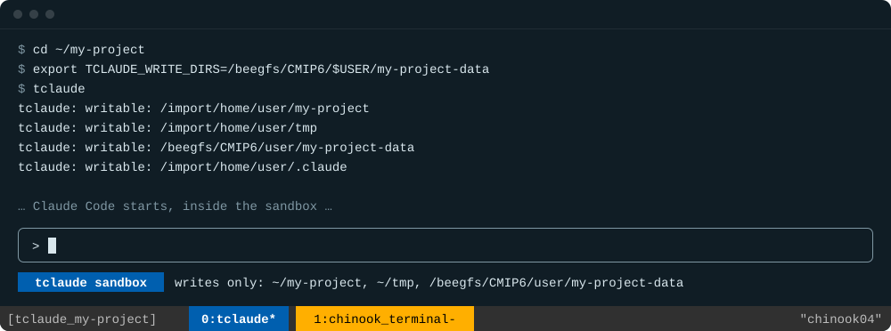
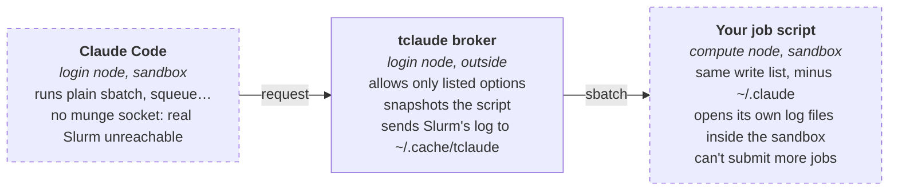

# tclaude

tclaude is designed to run Claude Code on Chinook in a persistent tmux session, using a bubblewrap sandbox to protect SNAP's data assets.

Claude can write only to the repo and the directories you list. Slurm jobs it submits run in the same sandbox on the compute node.

- No admin access needed
- Covers Bash, file edits, hooks and jobs
- An indicator under Claude's text box shows whether you're sandboxed
- `/import/SNAP` is always read-only, whatever you list
- 68-check test script



Everything else on the filesystem is read-only to Claude. The `writable:` lines scroll away when Claude starts; the indicator under the text box stays.

## Contents

- [What's in this repo](#whats-in-this-repo)
- [Why not Claude Code's own sandbox](#why-not-claude-codes-own-sandbox)
- [Why Slurm needs a broker](#why-slurm-needs-a-broker)
- [Setup](#setup)
- [Claude settings and rules](#claude-settings-and-rules)
- [Daily use](#daily-use)
- [Slurm from inside the sandbox](#slurm-from-inside-the-sandbox)
- [What it doesn't cover](#what-it-doesnt-cover)
- [Troubleshooting](#troubleshooting)

## What's in this repo

| Path | Installs to | What it is |
| --- | --- | --- |
| `bin/tclaude` | `~/.local/bin/tclaude` | The launcher, sandbox and Slurm broker |
| `bin/tclaude-test` | `~/.local/bin/tclaude-test` | Checks the sandbox allows and blocks writes as intended |
| `bin/tclaude-statusline` | `~/.local/bin/tclaude-statusline` | The sandbox indicator under Claude's text box |
| `config/tmux.conf` | `~/.tmux.conf` | tmux settings that suit Claude Code |
| `config/claude-settings.json` | `~/.claude/settings.json` | Permission rules enforced by Claude Code, and the indicator (template) |
| `config/claude-rules.md` | `~/.claude/CLAUDE.md` | Instructions Claude reads every session (template) |
| `docs/terminal.svg` | — | The terminal image at the top of this README |

## Why not Claude Code's own sandbox

Claude Code has a built-in sandbox, but it can't run on Chinook. On Linux it needs two system packages: `bubblewrap`, which isolates the filesystem, and `socat`, which relays the sandbox's network traffic through Claude Code's filtering proxy. Chinook has bubblewrap but not socat, and installing system packages needs an admin. Without socat the built-in sandbox doesn't start, and Claude runs unsandboxed.

We only need write isolation, and bubblewrap does that alone. It runs without root on Chinook because unprivileged user namespaces are enabled. So `tclaude` calls `bwrap` directly, and runs all of Claude inside it rather than just its shell commands:

- **The whole filesystem is mounted read-only.** Then the repo, `~/tmp`, Claude's state directory (`~/.claude`) and anything in `TCLAUDE_WRITE_DIRS` are mounted writable on top.
- **Protected directories stay read-only regardless.** `/import/SNAP`, SNAP's canonical data, is mounted read-only last, so listing it, or a directory that contains it, never makes it writable. A repo inside it is refused. The list is `protected_dirs` near the top of `bin/tclaude`; jobs get the same protection.
- **Every process Claude starts inherits the sandbox.** That covers Bash commands, Python or R scripts, Claude's Edit and Write tools, hooks, and MCP servers. The built-in sandbox covers Bash commands only.
- **The restriction comes from the kernel.** Writes outside the allowed directories fail with `Read-only file system`, however they're attempted.
- **Claude can't widen its own access.** Setting `TCLAUDE_WRITE_DIRS` inside the sandbox does nothing, and the `tclaude` script, `~/.bashrc` and your dotfiles are read-only to it. So are `~/.claude/settings.json` and `~/.claude/CLAUDE.md`, even though the rest of `~/.claude` is writable, so Claude can't loosen its own rules.

## Why Slurm needs a broker

A filesystem sandbox alone has a large hole on a cluster. Four facts about Slurm cause it:

1. **Jobs start outside the sandbox.** `sbatch` hands the job to the Slurm controller, and Slurm's daemons start it on a compute node. The job isn't a child of the sandboxed process, so it runs with your full permissions. One job script could write anywhere you can.
2. **Slurm opens log files itself.** It creates the `--output` and `--error` files before the job script runs, following symlinks. A job could have Slurm overwrite any file you own.
3. **Blocking the `sbatch` command isn't enough.** Any Slurm client, such as a copied binary, Python bindings or `srun`, talks to the controller through the munge authentication socket.
4. **Compute nodes don't have bubblewrap installed.** A copy in `~/.local/bin` does run there.

So `tclaude` hides the munge socket inside the sandbox, and nothing inside can reach Slurm directly. Instead, the Slurm commands inside the sandbox hand their arguments to a small broker. The broker is started by `tclaude` outside the sandbox and stops when Claude exits.



Dashed boxes run inside bubblewrap.

Options are checked against an allow-list because some `sbatch` options, such as `--export` and `--get-user-env`, could make the job's wrapper run code before its sandbox starts. That's also why a job gets the environment of the shell where you started `tclaude`, not Claude's shell.

## Setup

One time, about 10 minutes. All commands run in a Chinook shell.

### 1. Claude Code CLI

Install it even if you use Claude through VS Code; the extension's copy isn't on your PATH over plain SSH. You don't need root.

```bash
curl -fsSL https://claude.ai/install.sh | bash
grep -q 'local/bin' ~/.bashrc || cat >> ~/.bashrc <<'EOF'
# ~/.local/bin (claude, tclaude, bwrap) on PATH, including in tmux windows
case ":$PATH:" in *":$HOME/.local/bin:"*) ;; *) export PATH="$HOME/.local/bin:$PATH" ;; esac
EOF
source ~/.bashrc && claude --version
```

Run `claude` once outside tmux to log in. It prints a URL; open it on your laptop and paste the code back.

### 2. Get this repo

```bash
git clone https://github.com/ua-snap/tclaude.git ~/tclaude
cd ~/tclaude
```

### 3. tmux config

```bash
cp config/tmux.conf ~/.tmux.conf
```

This replaces any existing `~/.tmux.conf`; merge by hand if you have one.

### 4. A bubblewrap copy for compute nodes

```bash
cp "$(command -v bwrap)" ~/.local/bin/bwrap
```

### 5. Install the scripts

```bash
install -m 755 bin/tclaude bin/tclaude-test bin/tclaude-statusline ~/.local/bin/
```

Copy the scripts; don't symlink them into the clone. If `~/.local/bin/tclaude` pointed into `~/tclaude` and you ever ran `tclaude` from inside the clone, the clone would be writable to Claude, and Claude could edit the script that sandboxes it.

To update later, run `git pull`, then repeat the `install` command and step 6.

### 6. Run the tests

Takes 1–3 minutes.

```bash
cd ~ && tclaude-test
```

It should end with `0 failed`. It checks:

- which writes are allowed and which are blocked;
- `TCLAUDE_WRITE_DIRS` handling;
- that `~/.claude/settings.json` and `~/.claude/CLAUDE.md` are read-only, and the indicator is right inside and outside the sandbox;
- escape attempts: nested sandboxes and remounts;
- that real Slurm is unreachable from inside;
- the broker's refusals;
- three real jobs on `debug`.

The test takes two optional settings:

- `TCLAUDE_TEST_DATA=/a/data/dir` also confirms a real data directory is read-only. It creates and deletes one probe file there.
- `TCLAUDE_TEST_PARTITION=t1small` tests another partition.

Next, check that your own job scripts' options are accepted, without queuing anything. Run this in a repo:

```bash
tclaude exec sh -c 'for f in slurm/*.slurm; do echo "== $f"; sbatch --test-only "$f"; done'
```

## Claude settings and rules

Strongly recommended: the settings file also turns on the sandbox indicator. The sandbox stops writes outside the allowed directories. Inside a writable data directory, source files can still be changed. These two files add protection there, and tell Claude how the sandbox behaves so it doesn't fight it. Both go in `~/.claude/`. Replace `/path/to/datasets` with your own source data paths, or remove it. Run `realpath` on each path, including `/import/SNAP`, since Chinook paths often have aliases, such as `/home` and `/import/home`; a rule only matches the real path.

Inside the sandbox both files are read-only, so make changes from `chinook_terminal` or a plain shell, then restart Claude with `/exit` and `tclaude run --continue`.

**[`config/claude-settings.json`](config/claude-settings.json) → `~/.claude/settings.json`**, enforced by Claude Code. Merge it if the file exists.

```json
{
  "permissions": {
    "deny": [
      "Edit(//import/SNAP/**)",
      "Edit(//path/to/datasets/**)"
    ],
    "disableBypassPermissionsMode": "disable"
  },
  "disableAutoMode": "disable",
  "statusLine": {
    "type": "command",
    "command": "~/.local/bin/tclaude-statusline"
  }
}
```

- **Deny rules.** `//` means an absolute path. The rules block Claude's Edit and Write tools on everything under `/import/SNAP`, SNAP's canonical data, and under your own dataset paths. The sandbox already keeps `/import/SNAP` read-only, so its rule is a second layer. For your own dataset paths, the rule is a failsafe for when one of them is inside a directory in `TCLAUDE_WRITE_DIRS`. Deny rules don't cover shell commands, so a `cp` or `rm` from Bash in a writable directory still works. Only the sandbox stops those.
- **The two `disable` settings** stop anyone switching to modes that skip permission prompts.
- **`statusLine`** shows the indicator described in [Daily use](#daily-use).

**[`config/claude-rules.md`](config/claude-rules.md) → `~/.claude/CLAUDE.md`**, read by Claude every session. Append it if the file exists. It's named `claude-rules.md` here so Claude doesn't load it as instructions while working in this repo.

## Daily use

From your laptop, then on Chinook:

```bash
ssh <username>@<chinook-login-host>
cd ~/my-project
export TCLAUDE_WRITE_DIRS=/beegfs/CMIP6/$USER/my-project-data   # optional, colon-separated
tclaude
```

- **Check the indicator under Claude's text box.** `tclaude sandbox` on blue, followed by the directories Claude can write, means you're sandboxed. `NOT SANDBOXED` on amber means Claude can write anywhere you can. It tests whether your home directory is actually read-only, so it's right even if Claude was started some other way.
- **The tmux tabs are colour-coded too.** The `tclaude` window's tab is blue and the `chinook_terminal` tab is amber. The colours show what each window is for, not what's running in it: if Claude exits, the `tclaude` window is an ordinary unsandboxed shell. The indicator is what to trust.
- **`export` matters.** A plain `VAR=value` line isn't passed to `tclaude`. Missing directories are skipped with a warning. `/`, `$HOME` and its parent directories are refused, and so is anything inside `/import/SNAP`.
- **To change the write list mid-session,** type `/exit` in Claude, then `export TCLAUDE_WRITE_DIRS=…` and `tclaude run --continue`. The conversation resumes with the new list. A running sandbox can't be widened, so restarting is the only way.
- **Detach** with <kbd>Ctrl-b</kbd> <kbd>d</kbd>; Claude keeps working. To come back, run `tclaude` in the same repo on the same login node. Sessions live on the node where they started; `hostname` tells you which.
- **A reattached session keeps the write list it started with.** `tclaude` prints a reminder when that happens.
- **The `chinook_terminal` window is unsandboxed.** Use it for anything Claude can't do, such as MPI jobs or cancelling other jobs.
- **`tclaude exec <cmd>`** runs any command in the same sandbox, which is handy for checking a path.
- **The audit log** is `~/.cache/tclaude/broker.log`. It records every Slurm command Claude ran and every job it submitted.

| tmux keys | Action |
| --- | --- |
| <kbd>Ctrl-b</kbd> <kbd>d</kbd> | Detach; everything keeps running |
| <kbd>Ctrl-b</kbd> <kbd>n</kbd> / <kbd>p</kbd> | Next / previous window |
| <kbd>Ctrl-b</kbd> <kbd>s</kbd> | Pick a session |
| <kbd>Ctrl-b</kbd> <kbd>[</kbd> | Scroll back; <kbd>q</kbd> exits |
| <kbd>Ctrl-b</kbd> <kbd>z</kbd> | Zoom the current pane |
| Drag with <kbd>Option</kbd> (iTerm2), <kbd>Fn</kbd> (Terminal.app) or <kbd>Shift</kbd> | Select text for your laptop's clipboard |

## Slurm from inside the sandbox

| Command | | Notes |
| --- | --- | --- |
| `sbatch` | allowed | The script must be a file with a `#!` line. Only the options listed in [`config/claude-rules.md`](config/claude-rules.md) are accepted, from the command line or `#SBATCH` lines. Job arguments, arrays, dependencies and `--parsable` pipelines work as usual. |
| `squeue` `sacct` `sinfo` `sstat` `sprio` `sshare` | allowed | Read-only, passed through unchanged. |
| `scontrol` | show only | `scontrol show …` works; `hold`, `update` and the rest are refused. |
| `scancel` | own tclaude jobs | Job IDs only. Refused for jobs you submitted yourself. |
| `srun` `salloc` `sacctmgr` `scrontab` … | refused | Run them from `chinook_terminal`. MPI and multi-step jobs go there too. |

**Logs.** The job's own `--output` and `--error` files are opened inside the job's sandbox. If a path isn't writable, the job stops and the reason is in `~/.cache/tclaude/slurm-logs/<jobid>.out`. A job that writes logs to a data directory needs that directory in `TCLAUDE_WRITE_DIRS`.

**Snapshots.** Each submission copies its script to `~/.cache/tclaude/jobs/`, so later edits don't change a queued job. Clear old snapshots occasionally.

## What it doesn't cover

- **Reading and network access.** Claude can read everything you can and reach the internet. This setup limits writes only.
- **Writable directories are fully writable,** apart from `/import/SNAP`. Use the [rules above](#claude-settings-and-rules), or remove write permission with `chmod`, for data inside them that must not change.
- **Anything you run yourself,** including `chinook_terminal` and jobs you submit.
- **Passwordless SSH to other nodes.** A shell started over SSH isn't sandboxed. The test only checks `localhost`, so if you have SSH keys set up for other Chinook nodes, check those too.

## Troubleshooting

| Symptom | Cause and fix |
| --- | --- |
| The indicator says `NOT SANDBOXED` | That Claude wasn't started by `tclaude`, for example because `claude` was run directly in the window. Type `/exit`, then run `tclaude run --continue` to resume the conversation inside the sandbox. |
| No indicator under the text box | `statusLine` isn't in `~/.claude/settings.json`, or `tclaude-statusline` isn't installed. See [Claude settings and rules](#claude-settings-and-rules). |
| Claude can't save a setting | `~/.claude/settings.json` is read-only inside the sandbox. Edit it from `chinook_terminal`, then restart Claude. |
| The `writable:` list is missing your directory | `TCLAUDE_WRITE_DIRS` wasn't exported, or the path doesn't exist. Look for a "skipping" warning. |
| No `writable:` lines on screen | Claude clears the screen as it starts. Scroll back with <kbd>Ctrl-b</kbd> <kbd>[</kbd>. |
| `option … isn't allowed from the sandbox` | The option isn't on the allow-list, or it's abbreviated. Use the full name, or submit from `chinook_terminal`. |
| A job finished but its log file is missing | The log path isn't writable in the sandbox. See `~/.cache/tclaude/slurm-logs/<jobid>.out`. |
| `jobs need bubblewrap at ~/.local/bin/bwrap` | [Setup step 4](#4-a-bubblewrap-copy-for-compute-nodes) was skipped. |
| Claude asks you to log in again | That's expected once. Inside the sandbox, Claude keeps its config in `~/.claude/.claude.json`, a copy of `~/.claude.json` made on first launch. Settings you change with plain `claude` outside the sandbox don't carry over. |

---

Tested on Chinook in November 2026 with bubblewrap 0.4.0 and tmux 2.7, on the debug, t1small, analysis and transfer partitions. Run `tclaude-test` after any change to the scripts or the cluster.
